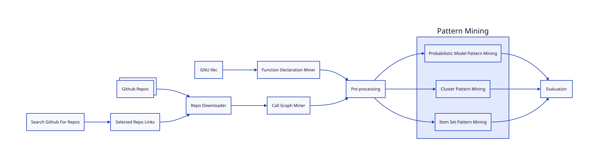

# Description



The present study's development was separated into a series of self contained
modules, each in their own sub-folder. In the interest of replicability, the
nix packaging system was used to lock the versions of the ressources needed to
obtain the results of the study. Thus, the sub-folders each contain the
following file: 

- default.nix : allows one to compile the main product of the module into a
  file, the contents of which depend on the module in question
- shell.nix : creates a shell environment containing all of the needed packages
  for operating and developping the files in the module in question.

To operate the former, utilize the command:
```sh 
  cd <sud-folder>
  nix-build
```

And to operate the latter utilize:
```sh
  cd <sub-folder>
  nix-shell
```
